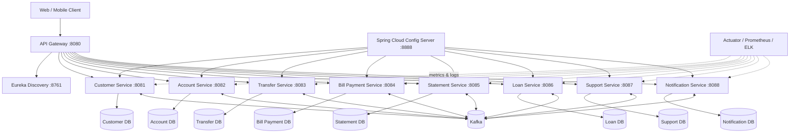
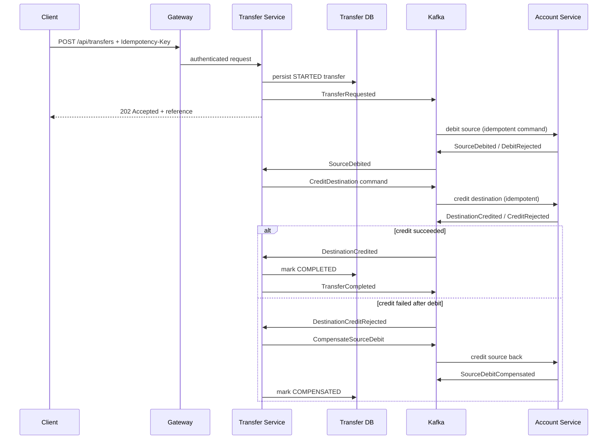

# Banking Microservices System — Architecture

## Component diagram

## Service responsibilities and ports

| Service | Port | Responsibility / BRD use cases |
|---|---:|---|
| API Gateway | 8080 | Single entry point, route predicates, load-balanced service IDs |
| Eureka Registry | 8761 | Service registration/discovery |
| Config Server | 8888 | Centralized external configuration via Git-backed repository |
| Customer Service | 8081 | Registration, profile update, identity-provider token validation integration |
| Account Service | 8082 | Accounts, balance inquiry, transaction history query |
| Transfer Service | 8083 | Fund transfers, Saga orchestration, compensation |
| Bill Payment Service | 8084 | Biller payment intent, payment status, provider adapter |
| Statement Service | 8085 | Period/date-range statement generation |
| Loan Service | 8086 | Loan application intake and acknowledgement |
| Support Service | 8087 | Customer support cases/tickets |
| Notification Service | 8088 | Email/SMS/push event adapter |

## Transfer Saga sequence

## Explanation
1. The Gateway is the only externally published application entry point. It routes by Eureka service ID and can load balance across service instances.
2. Each domain service owns its database/schema and business rules. Services do not directly read each other's databases.
3. REST is used for synchronous queries and request acknowledgement. Kafka is used for durable asynchronous workflows and domain events.
4. A transfer is not a single cross-database ACID transaction. The Saga persists each local step and uses a compensating credit if the destination-credit step fails after a successful debit.
5. A transfer idempotency key and event/command idempotency records are required to prevent duplicate debits/credits during at-least-once delivery.
6. Config Server supplies non-secret external settings. Secrets and encryption keys must come from a managed secrets system, not source control.
7. Actuator/Prometheus expose health and metrics; logs carry correlation IDs and audit events are persisted independently.

## Trust boundaries
- Validate issuer, audience, signature and expiry of OAuth2 JWTs at Gateway and/or service resource servers.
- Use TLS for all network hops. For production, use mTLS between services and Kafka TLS/SASL with ACLs.
- Encrypt sensitive PII before database persistence using AES-256-GCM and external key management with rotation.
- Never log credentials, tokens, full card data or unmasked personal identifiers.
- All account/payment endpoints must enforce ownership and authorization in the owning service, not only at Gateway.

## Operational caveats
The BRD's 200 ms p95, 100 TPS and 99.9% availability requirements are measurable service-level objectives, not something a source-code scaffold can guarantee. They require load tests, multi-zone deployments, capacity planning, dashboards, alerts, runbooks and operational review. GDPR/PCI DSS compliance also requires organizational and infrastructure controls beyond application code.
